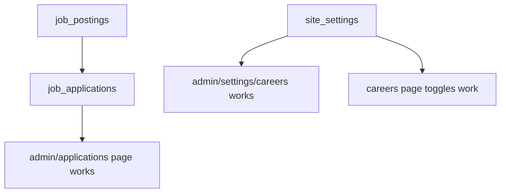

# Migration Status Check

## Required Migrations

You need to run these migrations in your Supabase database:

### 1. Job Applications Table ✅
**File:** `supabase/migrations/create_job_applications_table.sql`

**Purpose:** Stores job application submissions from the careers page

**How to Run:**
1. Open Supabase Dashboard → SQL Editor
2. Copy contents of the file
3. Paste and click "Run"

**Verify:**
```sql
SELECT COUNT(*) FROM job_applications;
```
Should return `0` (empty table, not an error)

---

### 2. Site Settings Table ⚠️ (CAUSING THE ERROR)
**File:** `supabase/migrations/create_site_settings_table.sql`

**Purpose:** Stores site configuration (careers page visibility, application settings)

**Error if not run:**
```
Error fetching homepage settings: {}
⚠️ site_settings table not found
```

**How to Run:**
1. Open Supabase Dashboard → SQL Editor
2. Copy contents of the file
3. Paste and click "Run"

**Verify:**
```sql
SELECT * FROM site_settings;
```
Should show 3 default settings

---

## Quick Run All Migrations

### Option 1: Supabase CLI (if installed)
```bash
supabase migration up
```

### Option 2: Manual (Recommended)
1. Open Supabase Dashboard
2. Go to SQL Editor
3. Run migrations in this order:
   - `create_job_applications_table.sql`
   - `create_site_settings_table.sql`

---

## Migration Dependencies



- ✅ `job_postings` - Already exists (you created this)
- ⏳ `job_applications` - Needs to run
- ⏳ `site_settings` - Needs to run (**this one is causing the error**)

---

## What Happens Without Migrations?

### Without `job_applications`:
- ❌ Application form submissions fail
- ❌ Admin applications page shows empty
- ✅ Everything else works

### Without `site_settings`:
- ⚠️ Console warning (but site still works with defaults)
- ❌ Admin careers settings page doesn't work
- ❌ Can't toggle careers page on/off
- ✅ Careers page shows jobs normally

---

## After Running Migrations

Your site will have:
- ✅ Job applications saved to database
- ✅ Applications visible in admin panel
- ✅ Real-time notifications for new applications
- ✅ Email notifications to admin
- ✅ Admin control over careers page
- ✅ Toggle between application methods
- ✅ No console errors

---

## Troubleshooting

### "relation already exists"
Table is already created. Skip that migration.

### "column does not exist"
Old table structure. Drop and recreate:
```sql
DROP TABLE IF EXISTS site_settings CASCADE;
-- Then run the migration
```

### "permission denied"
Check your Supabase project permissions.

---

## Next Steps

1. ✅ Run `create_site_settings_table.sql` (fixes the error)
2. ✅ Run `create_job_applications_table.sql` (completes job system)
3. ✅ Verify both tables exist
4. ✅ Test admin panels
5. ✅ Continue with audit fixes

**Estimated time:** 5 minutes
